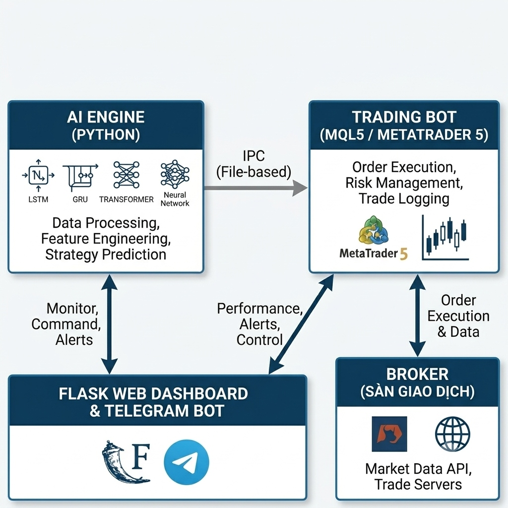

# CHƯƠNG 1. TỔNG QUAN VỀ BÀI TOÁN

*Chương 1 giới thiệu bối cảnh bài toán giao dịch tài chính, mô hình hệ thống hỗ trợ ra quyết định (DSS) và giải thích các thuật ngữ tài chính dưới góc nhìn Công nghệ thông tin. Tiếp đó, chương này trình bày các phương pháp tiếp cận hiện nay, chỉ ra các thách thức kỹ thuật cốt lõi, xác định mục tiêu, nhiệm vụ nghiên cứu và bố cục tổng thể của đồ án.*

---

## 1.1 Đặt vấn đề

### 1.1.1 Bối cảnh thực tế
Trong những năm gần đây, cuộc cách mạng công nghệ đã thúc đẩy mạnh mẽ quá trình số hóa trong lĩnh vực tài chính (FinTech). Thị trường tài chính quốc tế, đặc biệt là thị trường ngoại hối và kim loại quý (tiêu biểu là cặp tỷ giá Vàng/Đô la Mỹ - XAU/USD), hoạt động liên tục 24/5 với khối lượng giao dịch lên tới hàng nghìn tỷ USD mỗi ngày.

Đặc trưng cơ bản của dữ liệu tài chính là dữ liệu chuỗi thời gian (Time-series Data). Giá cả liên tục thay đổi từng giây, phản ánh sự tương tác phức tạp giữa cung và cầu của các tổ chức tài chính, quỹ đầu tư và các nhà giao dịch cá nhân trên toàn cầu [1].

Tại Việt Nam, nhu cầu tìm hiểu và tham gia thị trường tài chính của người dùng cá nhân ngày càng tăng cao. Cùng với định hướng phát triển kinh tế số của Chính phủ [2], việc ứng dụng các giải pháp phần mềm để hỗ trợ phân tích định lượng (Quantitative Trading) và giao dịch tự động theo thuật toán (Algorithmic Trading) đang trở thành xu hướng tất yếu nhằm thay thế cho cách thức giao dịch thủ công [3].

### 1.1.2 Khó khăn trong giao dịch thủ công
Giao dịch tài chính thủ công trên thị trường Vàng (XAU/USD) gặp phải ba khó khăn chính:

1. **Yếu tố tâm lý:** 
   Các nghiên cứu về tài chính hành vi chỉ ra rằng phần lớn thua lỗ của nhà đầu tư cá nhân xuất phát từ yếu tố tâm lý [4]. Lòng tham khi thị trường tăng giá dễ dẫn đến tâm lý sợ bỏ lỡ cơ hội (FOMO), trong khi nỗi sợ hãi khi tài khoản sụt giảm tạm thời dễ dẫn đến hành động cắt lỗ vội vàng hoặc nhồi lệnh thiếu kỷ luật.
2. **Hạn chế về thời gian và tốc độ xử lý:** 
   Thị trường tài chính biến động liên tục suốt ngày đêm. Con người không thể theo dõi màn hình liên tục 24 giờ mỗi ngày để vừa quan sát biểu đồ giá, vừa cập nhật tin tức kinh tế và ra quyết định đặt lệnh kịp thời.
3. **Độ biến động phức tạp của thị trường Vàng:** 
   Vàng là tài sản nhạy cảm cao với các thông tin kinh tế vĩ mô như lãi suất của Cục Dự trữ Liên bang Mỹ (FED), chỉ số lạm phát (CPI) và các biến động địa chính trị. Khi có tin tức kinh tế quan trọng, giá vàng có thể biến động rất mạnh chỉ trong vài phút, gây rủi ro lớn cho các nhà đầu tư không kịp phản ứng.

### 1.1.3 Mô hình hệ thống hỗ trợ ra quyết định (DSS)
Để giải quyết các khó khăn trên, đề tài áp dụng mô hình **Hệ thống hỗ trợ ra quyết định (Decision Support System - DSS)** trong Công nghệ phần mềm [6]. Đây là hệ thống thông tin giúp người dùng phân tích dữ liệu, đánh giá tình huống và đưa ra quyết định tối ưu.

Trong đồ án này, Hệ thống hỗ trợ ra quyết định giao dịch tài chính (VQuant) được thiết kế gồm 4 phân hệ chính:
- **Phân hệ quản lý dữ liệu (Data Management Subsystem):** Tự động thu thập dữ liệu giá nến (OHLCV) từ sàn giao dịch, làm sạch dữ liệu, khử nhiễu và tính toán các đặc trưng kỹ thuật.
- **Phân hệ quản lý mô hình (Model Management Subsystem):** Chứa mô hình học sâu (CNN-BiGRU-Attention) kết hợp thuật toán so khớp mẫu hình (Pattern Matcher) để dự báo xu hướng thị trường, cùng module xử lý ngôn ngữ tự nhiên (NLP FinBERT) để phân tích tin tức kinh tế.
- **Phân hệ quy tắc và quản trị rủi ro (Knowledge/Rule Base Subsystem):** Thực thi các thuật toán quản lý vốn lưới ma trận (DCA), cơ chế điều chỉnh khoảng cách theo biến động thực tế (ATR) và cơ chế khóa phòng hộ (Hedging) để bảo toàn vốn.
- **Phân hệ giao diện tương tác (User Interface Subsystem):** Bảng điều khiển trực quan (Dashboard) hiển thị trên biểu đồ giao dịch MetaTrader 5 và kênh cảnh báo, điều khiển từ xa qua Telegram Bot.

Kiến trúc tổng thể của Hệ thống hỗ trợ ra quyết định giao dịch tài chính VQuant được mô tả chi tiết trên Hình 1.1:

Từ các phân tích trên, đề tài tốt nghiệp được xác định là: **"Xây dựng hệ thống hỗ trợ ra quyết định giao dịch tài chính sử dụng dữ liệu chuỗi thời gian"**.

### 1.1.4 Các khái niệm cơ bản
Để giúp người đọc dễ dàng tiếp cận nội dung chuyên môn, Bảng 1.1 giải thích các thuật ngữ nghiệp vụ tài chính dưới góc nhìn kỹ thuật Công nghệ thông tin:

**Bảng 1.1: Diễn giải các khái niệm tài chính dưới góc nhìn công nghệ thông tin**

| Thuật ngữ nghiệp vụ | Ý nghĩa trong tài chính | Bản chất kỹ thuật trong hệ thống phần mềm |
| :--- | :--- | :--- |
| **XAU/USD** | Cặp tỷ giá Vàng giao ngay định giá bằng USD. | **Đối tượng dữ liệu chuỗi thời gian (Time-series)** cần thu thập, xử lý và dự báo xu hướng. |
| **Nến Nhật (OHLCV)** | Dạng biểu diễn biến động giá trong một khoảng thời gian cố định. | **Bản ghi dữ liệu (Data Record)** gồm 5 trường số thực: Mở cửa (Open), Cao nhất (High), Thấp nhất (Low), Đóng cửa (Close) và Khối lượng (Volume). |
| **Khung H4** | Chu kỳ thời gian 4 giờ cho mỗi cây nến. | **Bước lấy mẫu thời gian (Sampling Rate)**: Cứ mỗi 4 giờ, hệ thống tạo một mẫu dữ liệu mới để đưa vào mô hình AI suy luận. |
| **Pips / Points** | Đơn vị đo biến động giá nhỏ nhất. | **Đơn vị lượng tử hóa độ dịch chuyển số học** (với Vàng: $1 USD tương đương 100 points). |
| **DCA (Trung bình giá)** | Chiến thuật mở thêm lệnh khi giá tạm thời đi ngược hướng dự đoán. | **Thuật toán tối ưu hóa điểm hòa vốn (Break-even)**: Tự động tính giá vốn bình quân gia quyền để rổ lệnh có thể chốt lời khi giá có nhịp hồi ngắn. |
| **Hedging (Phòng hộ)** | Kỹ thuật mở vị thế đối ứng theo chiều ngược lại với khối lượng tương đương. | **Cơ chế ngắt mạch an toàn (Circuit Breaker)**: Đóng băng mức lỗ thả nổi, bảo toàn tài khoản khi thị trường xuất hiện biến động mạnh một chiều. |
| **Drawdown (Mức sụt giảm vốn)** | Tỷ lệ phần trăm sụt giảm tài khoản từ mức đỉnh vốn cao nhất. | **Chỉ số đánh giá độ an toàn của hệ thống** (yêu cầu hệ thống luôn duy trì mức sụt giảm dưới 25%). |
| **Tin đỏ (Tin tức vĩ mô mạnh)** | Các sự kiện kinh tế quan trọng theo lịch định kỳ (lãi suất FED, chỉ số CPI, Non-Farm). | **Sự kiện ngoại sinh (External Interrupts)**: Hệ thống tự động phát hiện qua API lịch kinh tế để tạm dừng mở lệnh trước thời điểm công bố tin. |
| **MetaTrader 5 (MT5) & MQL5** | Nền tảng giao dịch tài chính và ngôn ngữ lập trình hướng đối tượng chuyên dụng. | **Môi trường thực thi lệnh thời gian thực có độ trễ thấp (Execution Engine)**, chạy Robot viết bằng MQL5 (cú pháp tương tự C++). |
| **IPC (Giao tiếp liên tiến trình)** | Cơ chế truyền dữ liệu giữa các chương trình độc lập. | **Cầu nối trao đổi dữ liệu không đồng bộ** giữa tiến trình AI (Python) và tiến trình thực thi giao dịch (MT5) thông qua tệp JSON. |

---

## 1.2 Các phương pháp tiếp cận

Trong thực tế, có ba phương pháp chính để giải quyết bài toán phân tích và giao dịch tài chính:

### 1.2.1 Phương pháp phân tích kỹ thuật
Phương pháp phân tích kỹ thuật (Technical Analysis) dựa trên giả định rằng mọi thông tin thị trường đều được phản ánh qua biến động giá trong quá khứ. Các công cụ phân tích kỹ thuật thường được lập trình thành các robot giao dịch theo quy tắc cứng (Rule-based EA):
- **Nhóm chỉ báo xung lượng (Momentum):** Chỉ số sức mạnh tương đối (RSI), đường trung bình động hội tụ phân kỳ (MACD), chỉ báo dao động ngẫu nhiên (Stochastic).
- **Nhóm chỉ báo xu hướng và độ biến động (Trend & Volatility):** Đường trung bình động hàm mũ (EMA), dải Bollinger Bands, độ biến động thực tế trung bình (ATR).

*Hạn chế:* Các chỉ báo kỹ thuật truyền thống đều là các chỉ báo trễ (Lagging Indicators). Khi thị trường đi ngang (Sideway) hoặc gặp tin tức đột biến, các chỉ báo này thường phát ra nhiều tín hiệu giả, dẫn đến thua lỗ. Ngoài ra, các quy tắc cố định không có khả năng tự thích nghi khi thị trường thay đổi trạng thái.

### 1.2.2 Phương pháp phân tích cơ bản và tin tức
Phương pháp phân tích cơ bản (Fundamental Analysis) đánh giá giá trị tài sản dựa trên các báo cáo kinh tế vĩ mô. Đối với Vàng (XAU/USD), giá chịu tác động trực tiếp từ các tin tức kinh tế của Mỹ như lãi suất FED, báo cáo việc làm Non-Farm và chỉ số lạm phát CPI:
- Khi kinh tế Mỹ tăng trưởng mạnh và lạm phát cao, đồng USD mạnh lên khiến giá vàng chịu áp lực giảm.
- Khi có rủi ro địa chính trị hoặc suy thoái kinh tế, vàng đóng vai trò là tài sản trú ẩn an toàn, khiến giá vàng tăng.

*Hạn chế:* Việc theo dõi và đọc hiểu tin tức thủ công thường bị chậm trễ. Hiện nay, việc ứng dụng các mô hình Xử lý ngôn ngữ tự nhiên (NLP) như FinBERT hoặc VADER cho phép tự động hóa quá trình phân loại và tính điểm cảm xúc tin tức theo thời gian thực [5].

### 1.2.3 Phương pháp học máy và học sâu
Phương pháp hiện đại ứng dụng Trí tuệ nhân tạo (AI), Học máy (Machine Learning) và Học sâu (Deep Learning) vào phân tích dữ liệu chuỗi thời gian:
- **Mô hình học sâu kết hợp (CNN-BiGRU-Attention):** Sử dụng mạng tích chập 1D để trích xuất đặc trưng hình thái nến, mạng hồi quy BiGRU để học quy luật phụ thuộc thời gian hai chiều, và cơ chế Attention để tập trung vào các thời điểm bước ngoặt.
- **Thuật toán so khớp mẫu hình (Pattern Matcher):** Sử dụng độ đo tương đồng Cosine (Cosine Similarity) để so sánh hình thái nến hiện tại với kho dữ liệu nến trong quá khứ, cung cấp thêm góc nhìn xác suất cho hệ thống.
- **Kiến trúc hệ thống lai (Hybrid Architecture):** Đề tài kết hợp mô hình AI phân tích xu hướng chiến lược (Python), màng lọc tin tức vĩ mô (NLP) và Robot thực thi chiến thuật vi mô (MQL5 trên MetaTrader 5).

**Bảng 1.2: So sánh phương pháp truyền thống và phương pháp đề xuất**

| Tiêu chí | Phương pháp truyền thống (Rule-based EA) | Hệ thống đề xuất (VQuant AI) |
| :--- | :--- | :--- |
| **Cơ chế ra quyết định** | Dựa trên ngưỡng cố định (RSI > 70, MACD cắt qua 0) | Học quy luật phi tuyến từ 20 đặc trưng kỹ thuật và Attention |
| **Khả năng thích ứng** | Cố định, khó thích nghi khi thị trường đổi pha | Tự cập nhật và học hỏi từ dữ liệu chuỗi thời gian lớn |
| **Độ trễ tín hiệu** | Chỉ báo trễ, nhiều tín hiệu giả khi thị trường đi ngang | Kết hợp trích xuất mẫu nến (CNN) và bắt nhịp xu hướng (BiGRU) |
| **Phản ứng trước tin tức** | Không đọc được tin, dễ rủi ro khi có tin mạnh | Tự động quét lịch kinh tế và tạm dừng giao dịch khi có tin đỏ |
| **Quản trị rủi ro** | Đặt cắt lỗ cố định hoặc nhồi lệnh cố định rủi ro cao | Lưới DCA co giãn theo ATR và kích hoạt khóa phòng hộ Hedging |
| **Tính tự động và kỷ luật** | Phụ thuộc vào sự can thiệp thủ công của người dùng | Tự động hóa hoàn toàn, hỗ trợ giám sát từ xa qua Telegram |

---

## 1.3 Các thách thức kỹ thuật

Việc xây dựng hệ thống giao dịch tự động tích hợp trí tuệ nhân tạo đối mặt với 4 thách thức kỹ thuật chính:

1. **Dữ liệu tài chính có độ nhiễu cao:**
   Dữ liệu giá tài chính có tỷ lệ tín hiệu trên nhiễu (Signal-to-Noise Ratio) rất thấp và mang tính phi dừng. Nếu mô hình quá phức tạp sẽ dễ bị hiện tượng học vẹt (Overfitting) — hoạt động tốt trên dữ liệu quá khứ nhưng kém hiệu quả trong thực tế. Vì vậy, hệ thống cần sử dụng kiến trúc mạng gọn nhẹ, các kỹ thuật điều chuẩn (Dropout, Batch Normalization) và phương pháp gán nhãn thích nghi theo biến động (ATR Labeling).

2. **Biến động bất ngờ từ tin tức vĩ mô:**
   Thị trường Vàng thường biến động rất mạnh khi các chỉ số kinh tế lớn được công bố. Tại các thời điểm này, chênh lệch giá mua bán giãn rộng và thanh khoản suy giảm. Hệ thống cần có module tự động quét lịch tin tức kinh tế để chủ động ngưng giao dịch trước các khung giờ nhạy cảm.

3. **Tích hợp liên nền tảng (Cross-Platform IPC):**
   Mô hình AI được huấn luyện và chạy trên Python, trong khi nền tảng giao dịch thực thi lệnh là MetaTrader 5 (ngôn ngữ MQL5). Hai môi trường này hoạt động độc lập, do đó cần thiết kế cơ chế giao tiếp liên tiến trình (IPC) ổn định, độ trễ thấp và có cơ chế phòng vệ an toàn khi một bên gặp sự cố.

4. **Quản trị vốn và kiểm soát rủi ro:**
   Không có mô hình dự đoán nào đạt độ chính xác tuyệt đối. Do đó, hệ thống cần cơ chế quản lý vốn chặt chẽ: bước giá co giãn linh hoạt theo độ biến động thực tế (ATR), giới hạn số lượng lệnh tối đa và tự động khóa hòa vốn hoặc kích hoạt vị thế đối ứng (Hedging) khi thị trường biến động bất lợi.

---

## 1.4 Mục tiêu và nhiệm vụ nghiên cứu

### 1.4.1 Mục tiêu tổng quát
Nghiên cứu ứng dụng các mô hình học sâu và xử lý ngôn ngữ tự nhiên trong bài toán phân tích chuỗi thời gian tài chính. Thiết kế và cài đặt thực nghiệm **Hệ thống hỗ trợ ra quyết định giao dịch tài chính (VQuant)** cho cặp tỷ giá XAU/USD; kết hợp mô hình AI dự báo xu hướng, màng lọc tin tức kinh tế thời gian thực, Robot giao dịch tự động trên MetaTrader 5 và kênh giám sát qua Telegram.

### 1.4.2 Nhiệm vụ cụ thể
Để đạt được mục tiêu tổng quát, đồ án triển khai các nhiệm vụ sau:

1. **Nghiên cứu cơ sở lý thuyết:**
   - Tìm hiểu các chỉ báo phân tích kỹ thuật (EMA, ATR, RSI, Bollinger Bands, Stochastic).
   - Nghiên cứu mô hình học sâu tích hợp (Conv1D, BiGRU, Multi-Head Attention).
   - Nghiên cứu mô hình phân tích tin tức tài chính (NLP FinBERT, VADER).
   - Tìm hiểu nền tảng MetaTrader 5, ngôn ngữ MQL5 và cơ chế IPC.

2. **Thu thập và tiền xử lý dữ liệu:**
   - Thu thập dữ liệu nến lịch sử đa khung thời gian của cặp XAU/USD từ sàn giao dịch.
   - Xây dựng quy trình làm sạch dữ liệu, khử nhiễu và chuẩn hóa 20 đặc trưng kỹ thuật.
   - Áp dụng phương pháp gán nhãn thích nghi theo biến động (Adaptive ATR Labeling).

3. **Xây dựng Lõi AI Engine (Python):**
   - Huấn luyện mô hình CNN-BiGRU-Attention và thuật toán so khớp mẫu hình KNN.
   - Phát triển module tự động cào và phân tích tin tức kinh tế từ ForexFactory.
   - Thiết lập kênh truyền dữ liệu IPC gửi tín hiệu sang MetaTrader 5.

4. **Phát triển Robot giao dịch trên MetaTrader 5 (MQL5):**
   - Lập trình Expert Advisor theo hướng đối tượng (OOP) gồm các module nhận tín hiệu, quản trị lệnh và quản trị rủi ro.
   - Cài đặt chiến lược quản lý vốn lưới ma trận DCA co giãn theo ATR và cơ chế Hedging.
   - Thiết kế bảng điều khiển trực quan (Dashboard) hiển thị thông số trên biểu đồ.

5. **Xây dựng kênh giám sát qua Telegram:**
   - Phát triển Telegram Bot gửi cảnh báo tín hiệu mới, thông báo lịch tin tức và báo cáo lãi/lỗ định kỳ.

6. **Thực nghiệm và đánh giá hệ thống:**
   - Thực hiện kiểm thử trên dữ liệu lịch sử (Backtesting) để đo lường các chỉ số: Lợi nhuận (Net Profit), Tỷ lệ thắng (Win Rate), Hệ số lợi nhuận (Profit Factor) và Mức sụt giảm tối đa (Max Drawdown).
   - Vận hành thử nghiệm thực tế 24/7 trên tài khoản Demo để kiểm tra tính ổn định.

### 1.4.3 Kết quả dự kiến
- Báo cáo đồ án tốt nghiệp theo đúng quy chuẩn định dạng của PTIT.
- Bộ mã nguồn Lõi AI Engine và màng lọc tin tức vĩ mô (Python).
- Bộ trọng số mô hình đã được huấn luyện tối ưu (`model_real.h5` và `scaler.save`).
- Robot giao dịch tự động hoàn chỉnh (`Matrix_DCA.mq5`) chạy trên nền tảng MetaTrader 5.
- Kênh Telegram Bot giám sát và cảnh báo từ xa.
- Báo cáo kiểm định định lượng và kết quả kiểm thử hệ thống.

---

## 1.5 Bố cục đồ án

Nội dung đồ án được tổ chức thành **3 chương** chính:

- **Chương 1 (Tổng quan về bài toán):** Trình bày bối cảnh thực tế, mô hình hệ thống hỗ trợ ra quyết định (DSS), các khái niệm cơ bản, các phương pháp tiếp cận hiện nay, các thách thức kỹ thuật, mục tiêu nghiên cứu và bố cục đồ án.
- **Chương 2 (Cơ sở lý thuyết và công nghệ áp dụng):** Trình bày cơ sở toán học của các chỉ báo kỹ thuật, kiến trúc mô hình học sâu (CNN-BiGRU-Attention), thuật toán so khớp mẫu hình, mô hình xử lý ngôn ngữ tự nhiên (NLP FinBERT), nền tảng MetaTrader 5 và nguyên lý quản lý vốn ma trận DCA kết hợp Hedging.
- **Chương 3 (Thiết kế, cài đặt và đánh giá hệ thống VQuant):** Trình bày kiến trúc tổng thể của hệ thống, thiết kế chi tiết các phân hệ (Lõi AI Python, Robot MT5, Telegram Bot), kết quả thực nghiệm huấn luyện, kết quả kiểm thử quá khứ (Backtesting), đánh giá hiệu năng và kết luận hướng phát triển.

---

## 1.6 Tóm tắt chương 1

Trong Chương 1, đồ án đã trình bày bối cảnh thực tế và lý do chọn đề tài; giải thích rõ các thuật ngữ nghiệp vụ tài chính dưới góc nhìn Công nghệ thông tin; phân tích ưu nhược điểm của các phương pháp phân tích kỹ thuật, phân tích cơ bản và phương pháp học máy. Chương này cũng đã xác định 4 thách thức kỹ thuật chính, mục tiêu nghiên cứu, các nhiệm vụ cụ thể cùng cấu trúc 3 chương của đồ án.

Trên cơ sở đó, **Chương 2** tiếp theo sẽ đi sâu vào **Cơ sở lý thuyết và công nghệ áp dụng**, trình bày chi tiết nền tảng toán học của mô hình học sâu, màng lọc tin tức NLP, nền tảng MetaTrader 5 và thuật toán quản lý vốn.
