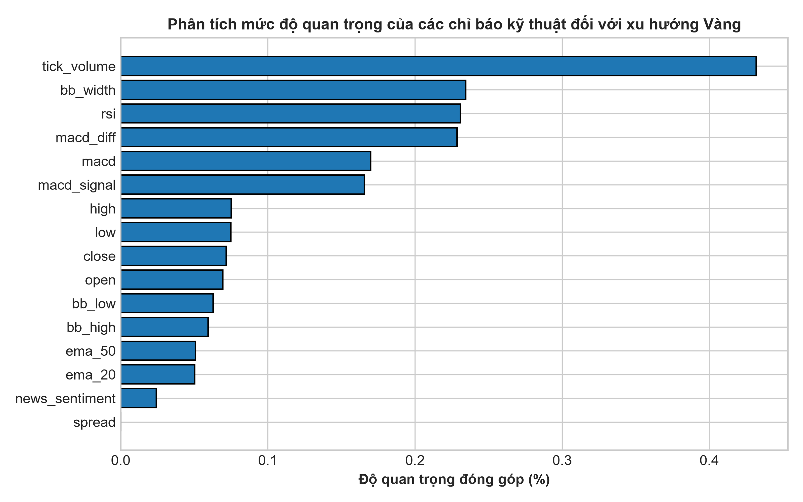
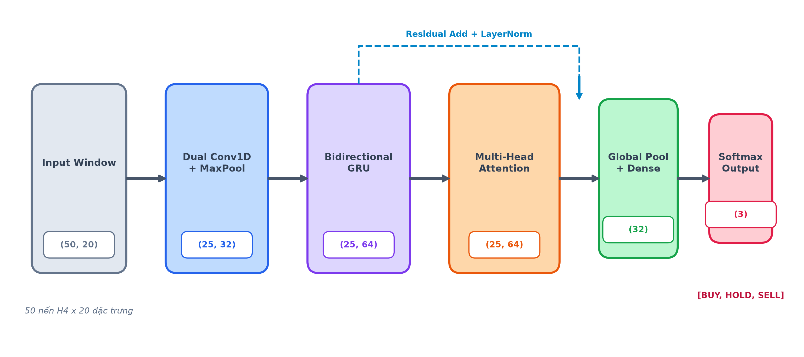
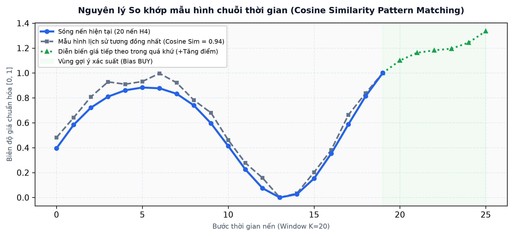
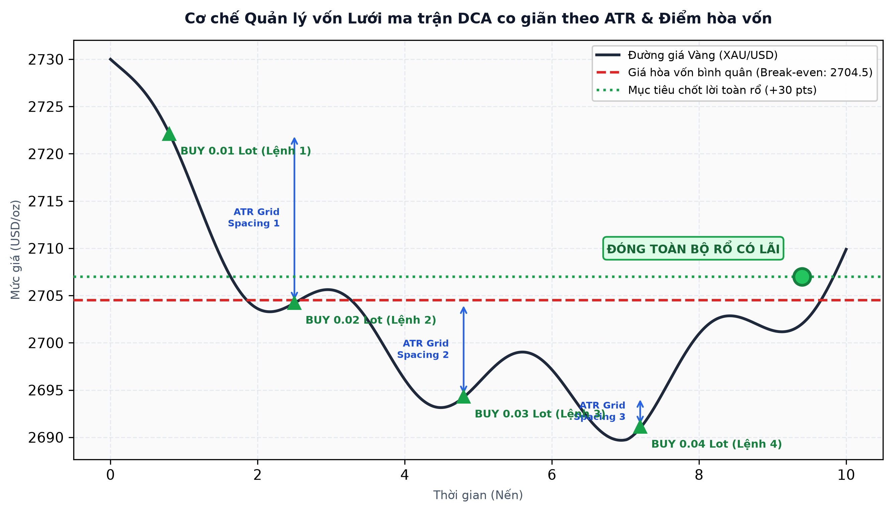
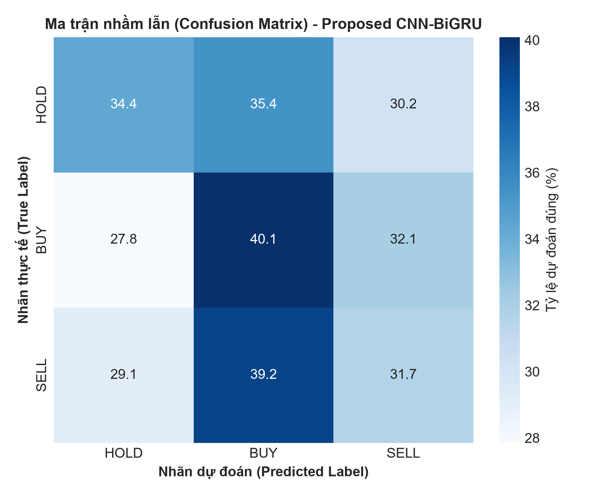

# CHƯƠNG 2. CƠ SỞ LÝ THUYẾT VÀ CÔNG NGHỆ ÁP DỤNG

*Chương 2 trình bày cơ sở lý thuyết toán học và các công nghệ nền tảng được áp dụng trong hệ thống hỗ trợ ra quyết định VQuant. Nội dung bao gồm: đặc điểm dữ liệu chuỗi thời gian XAU/USD và bảng tổng hợp 20 chỉ báo kỹ thuật; cơ sở toán học của mạng tích chập 1D-CNN, mạng hồi quy BiGRU, cơ chế Multi-Head Attention và mô hình đề xuất CNN-BiGRU-Attention; thuật toán so khớp mẫu hình Cosine Similarity; mô hình ngôn ngữ FinBERT và từ điển VADER; nền tảng MetaTrader 5 (MQL5) và giao tiếp liên tiến trình IPC; thuật toán quản lý vốn ma trận DCA co giãn theo ATR và chiến lược phòng hộ Hedging; cùng các độ đo đánh giá hệ thống.*

---

## 2.1 Phân tích kỹ thuật và xử lý dữ liệu chuỗi thời gian

### 2.1.1 Đặc điểm dữ liệu cặp tỷ giá XAU/USD
Cặp tỷ giá Vàng giao ngay so với Đô la Mỹ (**XAU/USD**) là một trong những sản phẩm tài chính có tính thanh khoản cao nhất thế giới, với khối lượng giao dịch bình quân vượt 150 tỷ USD mỗi ngày. Thị trường hoạt động liên tục 24/5 từ thứ Hai đến thứ Sáu.

Dữ liệu chuỗi thời gian của cặp XAU/USD có 3 đặc điểm động học cơ bản:
1. **Biên độ biến động lớn:** Biên độ dao động trung bình hàng ngày (Daily ATR) của vàng thường nằm trong khoảng $20 - $40/ounce, và có thể lên tới $60 - $100/ounce khi xuất hiện các sự kiện kinh tế hoặc địa chính trị bất ngờ.
2. **Tương quan chặt chẽ với các biến số vĩ mô:** Giá vàng chịu tác động nghịch biến rõ nét từ chỉ số Dollar Index (DXY) và chính sách lãi suất của Cục Dự trữ Liên bang Mỹ (FED). Khi đồng USD mạnh lên, giá vàng chịu áp lực giảm và ngược lại.
3. **Tính chất phi tuyến và tỷ lệ nhiễu cao:** Khoảng 65% – 70% thời gian thị trường nằm trong trạng thái tích lũy dao động hẹp (Sideway), và chỉ khoảng 30% – 35% thời gian xuất hiện xu hướng rõ ràng (Trending).

### 2.1.2 Các chỉ báo kỹ thuật cốt lõi
Để chuyển đổi dữ liệu nến thô (OHLCV) thành không gian đặc trưng toán học phục vụ huấn luyện mô hình học sâu, hệ thống trích xuất **20 đặc trưng kỹ thuật định lượng** thuộc 4 nhóm chính: xu hướng (Trend), động lượng (Momentum), độ biến động (Volatility) và khối lượng (Volume). Bảng 2.1 tổng hợp chi tiết các đặc trưng được sử dụng trong mã nguồn hệ thống:

**Bảng 2.1: Bảng tổng hợp 20 đặc trưng kỹ thuật tài chính đầu vào của hệ thống**

| STT | Tên đặc trưng | Nhóm chỉ báo | Ký hiệu / Mô tả ngắn | Miền giá trị chuẩn hóa |
| :---: | :--- | :--- | :--- | :---: |
| 1 | **EMA_20** | Xu hướng | Đường trung bình động hàm mũ 20 chu kỳ | $[0, 1]$ |
| 2 | **EMA_50** | Xu hướng | Đường trung bình động hàm mũ 50 chu kỳ | $[0, 1]$ |
| 3 | **EMA_200** | Xu hướng | Đường trung bình động hàm mũ 200 chu kỳ | $[0, 1]$ |
| 4 | **EMA_Diff** | Động lượng | Độ lệch tương đối: $(EMA_{20} - EMA_{50}) / EMA_{50}$ | $[-1, 1]$ |
| 5 | **RSI_14** | Động lượng | Chỉ số sức mạnh tương đối 14 chu kỳ ($RSI / 100$) | $[0, 1]$ |
| 6 | **MACD_Line** | Động lượng | Hiệu số hai đường trung bình động: $EMA_{12} - EMA_{26}$ | $[-1, 1]$ |
| 7 | **MACD_Signal** | Động lượng | Đường tín hiệu: $EMA_9(\text{MACD Line})$ | $[-1, 1]$ |
| 8 | **MACD_Hist** | Động lượng | Histogram xung lực: $\text{MACD Line} - \text{Signal Line}$ | $[-1, 1]$ |
| 9 | **BB_Upper** | Biến động | Dải trên Bollinger Bands ($SMA_{20} + 2\sigma$) | $[0, 1]$ |
| 10 | **BB_Lower** | Biến động | Dải dưới Bollinger Bands ($SMA_{20} - 2\sigma$) | $[0, 1]$ |
| 11 | **BB_Width** | Biến động | Độ co thắt dải băng: $(\text{Upper} - \text{Lower}) / \text{Middle}$ | $[0, 1]$ |
| 12 | **BB_PctB** | Biến động | Vị trí giá tương quan: $(Close - \text{Lower}) / (\text{Upper} - \text{Lower})$ | $[0, 1]$ |
| 13 | **Stoch_K** | Động lượng | Đường dao động ngẫu nhiên $\%K$ chu kỳ 14 | $[0, 1]$ |
| 14 | **Stoch_D** | Động lượng | Đường tín hiệu dao động $\%D = SMA_3(\%K)$ | $[0, 1]$ |
| 15 | **ROC_10** | Động lượng | Tốc độ thay đổi giá so với 10 nến trước | $[-1, 1]$ |
| 16 | **ATR_14** | Biến động | Độ biến động thực tế trung bình 14 chu kỳ | $[0, 1]$ |
| 17 | **ATR_Ratio** | Biến động | Tỷ số biến động: $ATR_{14} / Close$ | $[0, 1]$ |
| 18 | **Body_Size** | Hình thái nến | Tỷ lệ thân nến chuẩn hóa: $\text{abs}(Close - Open) / (High - Low)$ | $[0, 1]$ |
| 19 | **Upper_Shadow**| Hình thái nến | Tỷ lệ bóng nến trên: $(High - \max(Open, Close)) / (High - Low)$ | $[0, 1]$ |
| 20 | **Volume_Ratio**| Khối lượng | Tỷ số khối lượng giao dịch so với trung bình 20 nến | $[0, 1]$ |

Trong các chỉ báo trên, **Độ biến động thực tế trung bình (Average True Range - ATR)** đóng vai trò trọng tâm trong toàn bộ hệ sinh thái VQuant. Nó vừa là đặc trưng đầu vào cho mô hình AI, vừa là tham số điều khiển thuật toán lưới lệnh DCA co giãn trong Robot MQL5. Khoảng biến động thực tế ($TR$) tại nến $t$ và chỉ số $ATR$ chu kỳ 14 được tính toán theo công thức:

$$TR_t = \max \left( High_t - Low_t, \, |High_t - Close_{t-1}|, \, |Low_t - Close_{t-1}| \right)$$

$$ATR_{14, t} = \frac{ATR_{14, t-1} \times 13 + TR_t}{14}$$

Mức độ đóng góp và tầm quan trọng của từng nhóm đặc trưng kỹ thuật đối với mô hình dự báo được thể hiện trực quan trên biểu đồ Hình 2.1:

---

## 2.2 Các mô hình học sâu và so khớp mẫu hình

### 2.2.1 Mạng nơ-ron tích chập một chiều (1D-CNN)
Mạng tích chập một chiều (1D-CNN) là giải pháp hiệu quả để trích xuất các mẫu hình nến cục bộ (Local Candle Patterns) từ dữ liệu chuỗi thời gian đa biến.

Phép tích chập 1D thực hiện trượt một bộ lọc (Kernel) kích thước $(k, d)$ dọc theo trục thời gian:

$$y_t = \text{ReLU} \left( \sum_{i=0}^{k-1} W_i \cdot x_{t+i} + b \right)$$

Trong đó $x_t \in \mathbb{R}^d$ là vector đặc trưng tại bước thời gian $t$ ($d = 20$), $W$ là ma trận trọng số bộ lọc và $b$ là hệ số điều chỉnh bias. 

Nhờ cơ chế chia sẻ trọng số (Weight Sharing) và tính bất biến tịnh tiến cục bộ (Local Translation Invariance), tầng 1D-CNN tự động nhận diện các hình thái nến đảo chiều quan trọng (như nến Pinbar rút râu, nến nhấn chìm Engulfing) mà không làm bùng nổ số lượng tham số cần huấn luyện.

### 2.2.2 Mạng hồi quy có cổng hai chiều (BiGRU)
Để mô hình hóa sự phụ thuộc thời gian dài hạn mà không gặp phải hiện tượng triệt tiêu đạo hàm, đề tài lựa chọn kiến trúc **GRU (Gated Recurrent Unit)** thay vì LSTM truyền thống, bởi GRU tinh gọn hơn (giảm 25% tham số), tốc độ huấn luyện nhanh và giảm thiểu rủi ro quá khớp trên tập dữ liệu chuỗi tài chính.

Cơ chế điều khiển dòng thông tin của đơn vị GRU tại mỗi bước thời gian $t$ được định nghĩa qua các cổng và trạng thái sau:

–  **Cổng cập nhật (Update Gate):** Quyết định tỷ lệ thông tin từ trạng thái trước cần được duy trì:
$$z_t = \sigma(W_z x_t + U_z h_{t-1} + b_z)$$

–  **Cổng đặt lại (Reset Gate):** Xác định mức độ thông tin từ trạng thái quá khứ cần được loại bỏ:
$$r_t = \sigma(W_r x_t + U_r h_{t-1} + b_r)$$

–  **Trạng thái ẩn ứng viên (Candidate Hidden State):** Kết hợp vector đầu vào mới và thông tin quá khứ đã được lọc qua cổng đặt lại:
$$\tilde{h}_t = \tanh\left(W_h x_t + U_h (r_t \odot h_{t-1}) + b_h\right)$$

–  **Vector trạng thái ẩn chính thức (Hidden State):** Tuyến tính hóa giữa trạng thái cũ và ứng viên mới theo cổng $z_t$:
$$h_t = (1 - z_t) \odot h_{t-1} + z_t \odot \tilde{h}_t$$

Trên một cửa sổ trượt $T = 50$ nến H4, kiến trúc **BiGRU (Bidirectional GRU)** xem xét chuỗi theo cả hai chiều thuận (từ quá khứ đến hiện tại) và nghịch (từ hiện tại về quá khứ) để tạo ra vector trạng thái tổng hợp $H_t$:

$$H_t = [\overrightarrow{h}_t \,\|\, \overleftarrow{h}_t] = [\overrightarrow{\text{GRU}}(x_t, \vec{h}_{t-1}) \,\|\, \overleftarrow{\text{GRU}}(x_t, \overleftarrow{h}_{t+1})]$$

### 2.2.3 Cơ chế Chú ý đa đầu (Multi-Head Self-Attention)
Trong một chuỗi 50 nến, các cây nến biến động bước ngoặt (Breakout hoặc nến tin vĩ mô) có tầm ảnh hưởng lớn hơn nhiều so với các nến tích lũy nhỏ. Cơ chế Chú ý (Self-Attention) cho phép mô hình tự động phân bổ trọng số tập trung vào những nến quan trọng này.

Ma trận trọng số chú ý được tính thông qua tích vô hướng chuẩn hóa giữa Truy vấn ($Q$), Khóa ($K$) và Giá trị ($V$):

$$\text{Attention}(Q, K, V) = \text{softmax}\left( \frac{Q K^T}{\sqrt{d_k}} \right) V$$

Trong đó hệ số chia $\sqrt{d_k}$ giúp ổn định gradient. Mô hình mở rộng sang kiến trúc **Multi-Head Attention** gồm $h = 4$ đầu chú ý song song kết hợp tầng kết nối tắt phần dư (Residual Connection) và chuẩn hóa tầng (LayerNorm):

$$\text{Output}_{\text{Attn}} = \text{LayerNorm}\left( H + \text{MultiHead}(H, H, H) \right)$$

### 2.2.4 Mô hình đề xuất CNN-BiGRU-Attention
Mô hình đề xuất **CNN-BiGRU-Attention** tích hợp điểm mạnh của cả ba cơ chế trên thành một đường ống luồng tensor liền mạch:
–  **Khối Dual Conv1D:** Conv1D (48 bộ lọc, kernel=3) $\rightarrow$ BatchNorm $\rightarrow$ Conv1D (32 bộ lọc, kernel=3) $\rightarrow$ MaxPooling1D(2).
–  **Khối BiGRU:** 32 units xử lý chuỗi hai chiều.
–  **Khối Multi-Head Attention:** 4 heads chú ý độc lập cân chỉnh trọng số nến.
–  **Tầng nén & Phân loại:** GlobalAveragePooling1D nén chuỗi thời gian, đi qua Dense(32) $\rightarrow$ Dropout(0.2) $\rightarrow$ Dense(16) $\rightarrow$ Dense(3, Softmax) để xuất ra phân phối xác suất 3 lớp: $[P(\text{HOLD}), P(\text{BUY}), P(\text{SELL})]$.

Để khắc phục hiện tượng mất cân bằng nhãn (lớp HOLD chiếm đa số), mô hình sử dụng hàm mất mát Categorical Cross-Entropy có trọng số phạt nghịch đảo tần suất lớp (Class Weights):

$$\mathcal{L} = - \sum_{c=1}^{3} w_c \cdot y_c \cdot \log(\hat{y}_c), \quad w_c = \frac{N_{\text{total}}}{3 \times N_c}$$

Sơ đồ cấu trúc mạng dạng khối tensor trực quan và luồng biến đổi dữ liệu được thể hiện trên Hình 2.2:

### 2.2.5 Thuật toán so khớp mẫu hình (KNN Pattern Matcher)
Bên cạnh mô hình học sâu, hệ thống kết hợp thuật toán so khớp mẫu hình dựa trên nguyên lý: "Biến động thị trường trong quá khứ có xu hướng tự lặp lại".

Vector hình thái $K=20$ nến hiện tại $P$ và các cửa sổ quá khứ $Q_j$ được chuẩn hóa Min-Max cục bộ về đoạn $[0, 1]$:

$$\bar{p}_i = \frac{p_i - \min(P)}{\max(P) - \min(P)}$$

Độ tương đồng hình thái sóng giá được đo lường bằng độ đo góc Cosine (Cosine Similarity):

$$\text{Sim}(\bar{P}, \bar{Q}_j) = \frac{\bar{P} \cdot \bar{Q}_j}{\|\bar{P}\|_2 \cdot \|\bar{Q}_j\|_2} = \frac{\sum_{i=1}^{K} \bar{p}_i \bar{q}_{j,i}}{\sqrt{\sum_{i=1}^{K} \bar{p}_i^2} \sqrt{\sum_{i=1}^{K} \bar{q}_{j,i}^2}}$$

Thuật toán chọn ra Top 5 kịch bản lịch sử có độ tương đồng cao nhất ($\text{Sim} \ge 0.90$) để đưa ra gợi ý xác suất (Probability Bias) hỗ trợ mô hình học sâu. Nguyên lý so khớp hình thái sóng được minh họa trực quan trên Hình 2.3:

---

## 2.3 Xử lý ngôn ngữ tự nhiên trong phân tích tin tức

### 2.3.1 Mô hình ngôn ngữ FinBERT
**FinBERT** là mô hình xử lý ngôn ngữ tự nhiên dựa trên Transformer hai chiều (BERT), được huấn luyện chuyên sâu trên tập ngữ liệu tài chính khổng lồ từ Wall Street (Financial PhraseBank, báo cáo thường niên 10-K, 10-Q, tin tức Reuters, Bloomberg). 

Nhờ đó, FinBERT hiểu chính xác ngữ nghĩa chuyên ngành của các thuật ngữ kinh tế (ví dụ: từ "hawkish" thể hiện chính sách tiền tệ thắt chặt, từ "rate hike" thể hiện tăng lãi suất), phân loại sắc thái tin tức thành 3 nhãn: Tích cực (Positive), Tiêu cực (Negative) hoặc Trung tính (Neutral).

### 2.3.2 Phân tích cảm xúc kết hợp từ điển VADER
Để đạt tốc độ xử lý microsecond trên máy trạm thực thi, hệ thống tích hợp bộ từ điển sắc thái tài chính mở rộng **VADER Financial Lexicon**:

**Bảng 2.2: Bảng trọng số từ khóa kinh tế vĩ mô trong hệ thống**

| Từ khóa kinh tế vĩ mô | Nhóm tác động | Trọng số tác động | Ý nghĩa thực tế |
| :--- | :---: | :---: | :--- |
| `hawkish` / `rate hike` | USD tăng / Vàng giảm | +3.5 | Lãi suất tăng khiến vàng chịu áp lực bán |
| `dovish` / `rate cut` | USD giảm / Vàng tăng | -3.5 | Hạ lãi suất kích thích dòng vốn vào vàng |
| `inflation surge` / `sticky cpi` | USD tăng / Vàng giảm | +2.8 | Lạm phát dai dẳng khiến FED duy trì thắt chặt |
| `geopolitical tension` / `war crisis` | Vàng trú ẩn tăng | +4.0 | Rủi ro địa chính trị thúc đẩy mua vàng an toàn |
| `recession fears` / `banking crisis` | Vàng trú ẩn tăng | +3.2 | Khủng hoảng kinh tế làm tăng nhu cầu tích trữ vàng |

### 2.3.3 Thuật toán đảo chiều cảm xúc vĩ mô
Phần lớn tin tức kinh tế quốc tế phản ánh sức khỏe của đồng USD. Đối với cặp tỷ giá XAU/USD, tin tức kinh tế Mỹ tích cực sẽ làm đồng USD tăng giá mạnh nhưng lại tạo áp lực bán tháo lên Vàng. Do đó, hệ thống thiết lập cơ chế đảo chiều cảm xúc:

$$\text{Sentiment}_{\text{Final}}(XAU) = 
\begin{cases} 
- \text{Score}_{USD} & \text{với tin tức kinh tế Mỹ (FED, CPI, Non-Farm, GDP)} \\
+ \text{Score}_{\text{SafeHaven}} & \text{với tin tức địa chính trị, chiến tranh, khủng hoảng} \\
0 & \text{với tin tức trung tính hoặc không liên quan}
\end{cases}$$

Điểm cảm xúc $\text{Sentiment}_{\text{Final}} \in [-1.0, +1.0]$ được sử dụng để điều chỉnh xác suất vào lệnh. Khi phát hiện tin tức kinh tế cực mạnh (Tin đỏ sắp công bố trong vòng 30 phút), màng lọc Sentinel 24/7 sẽ phát tín hiệu ngắt mạch an toàn (News Circuit Breaker) để tạm dừng mở vị thế mới.

---

## 2.4 Nền tảng MetaTrader 5 và cơ chế giao tiếp liên tiến trình

### 2.4.1 Nền tảng MetaTrader 5 và ngôn ngữ MQL5
**MetaTrader 5 (MT5)** là nền tảng giao dịch tài chính tiêu chuẩn thế giới, cung cấp khả năng khớp lệnh tốc độ cao (mili-giây) và quản lý tài khoản trực tiếp với các sàn môi giới (Broker).

Robot Expert Advisor được lập trình bằng ngôn ngữ **MQL5** theo mô hình Lập trình hướng đối tượng (OOP), chia thành các lớp chức năng độc lập:
–  `CInputs`: Quản lý và chuẩn hóa toàn bộ tham số cấu hình.
–  `CFileBridge`: Lắng nghe và đọc tệp tín hiệu từ tiến trình Python.
–  `CFilters`: Tính toán các chỉ báo kỹ thuật trực tiếp trên đồ thị nến.
–  `CGridManager`: Quản lý thuật toán lưới DCA và tính toán điểm hòa vốn.
–  `COrderManager`: Đóng gói và gửi yêu cầu giao dịch `MqlTradeRequest` tới máy chủ sàn.
–  `CDashboard`: Bảng điều khiển giao diện đồ họa nút bấm trực tiếp trên biểu đồ.

### 2.4.2 Cơ chế giao tiếp liên tiến trình (IPC)
Tiến trình phân tích AI chạy trên Python và Robot thực thi lệnh chạy trên MetaTrader 5 hoạt động độc lập trong hai không gian bộ nhớ riêng biệt. Hệ thống thiết lập cầu nối giao tiếp liên tiến trình (IPC) thông qua tệp chia sẻ trung gian (`vc_signal_XAUUSDm.txt`) đặt tại thư mục dùng chung của MT5 (`Common/Files`).

Mỗi chu kỳ nến H4, Python xuất ra bản ghi định dạng JSON:
`{"timestamp": "2026-10-25 14:00:00", "signal": "BUY", "confidence": 0.68, "atr": 28.5}`

Mỗi khi đọc tệp tín hiệu, Robot MQL5 kiểm tra độ trễ thời gian $\Delta T = T_{\text{current}} - T_{\text{signal}}$. Nếu $\Delta T > 4\text{ giờ}$ hoặc tệp không tồn tại, Robot tự động kích hoạt trạng thái an toàn `AI_OFFLINE / FAILSAFE`, hiển thị cảnh báo trên biểu đồ và chuyển sang chế độ tự hành bảo toàn vốn, ngăn chặn rủi ro thực thi theo tín hiệu cũ đã lỗi thời.

---

## 2.5 Thuật toán quản lý vốn và phòng ngừa rủi ro

### 2.5.1 Giới hạn của dự báo và vai trò của quản lý vốn
Thị trường tài chính là một hệ thống ngẫu nhiên bán hiệu quả, thường xuyên xuất hiện các sự kiện đột biến không thể dự báo chính xác 100%. Một hệ thống giao dịch tự động không thể chỉ phụ thuộc vào độ chính xác của mô hình học máy mà yếu tố quyết định sự tồn tại lâu dài là **thuật toán quản lý vốn và kiểm soát rủi ro**.

Triết lý của hệ thống: **AI định hướng xu hướng vĩ mô — Thuật toán quản lý vốn lưới ma trận bảo vệ tài khoản và khai thác lợi nhuận vi mô**.

### 2.5.2 Thuật toán lưới DCA co giãn theo ATR
Chiến lược trung bình giá (DCA) truyền thống sử dụng bước giá cố định (ví dụ: cách nhau 20 points). Khi thị trường xuất hiện bão giá biến động hàng trăm USD, việc nhồi lệnh dày đặc sẽ nhanh chóng làm cạn kiệt tiền ký quỹ dẫn đến cháy tài khoản.

Hệ thống VQuant giải quyết triệt để rủi ro này bằng thuật toán **Lưới DCA co giãn theo biến động ATR**:

#### 1. Bước giá co giãn động
Khoảng cách giá để mở lệnh thứ $k$ ($k \ge 1$) được điều chỉnh tự động theo công thức:

$$\text{Spacing}_k = \text{BaseSpacing} \times \left( \frac{ATR_{14, \text{current}}}{ATR_{14, \text{baseline}}} \right) \times \gamma^{(k-1)}$$

Trong đó $\text{BaseSpacing}$ là bước giá cơ sở, $ATR_{14, \text{current}}$ là độ biến động nến thực tế tại thời điểm mở lệnh, và $\gamma \ge 1.0$ là hệ số giãn nở bước giá lũy tiến (ví dụ: $\gamma = 1.15$). Khi thị trường biến động mạnh, bước giá tự động dãn rộng để giảm thiểu số lượng lệnh phải gánh.

#### 2. Khối lượng lũy tiến kiểm soát
Khối lượng lệnh thứ $k$ tuân theo nguyên tắc:

$$\text{Lot}_k = \min \left( \text{BaseLot} \times \beta^{(k-1)}, \, \text{MaxLotLimit} \right)$$

Hệ số nhân $\beta$ được cấu hình ở mức thận trọng ($1.2 \le \beta \le 1.4$), tránh nhân đôi lot theo kiểu Martingale nguy hiểm ($\beta = 2.0$).

#### 3. Điểm hòa vốn tổng hòa (Consolidated Break-Even Target)
Thay vì chốt lời từng lệnh đơn lẻ, thuật toán tính toán mức giá hòa vốn bình quân gia quyền của toàn bộ rổ lệnh:

$$P_{\text{BreakEven}} = \frac{\sum_{i=1}^{m} \text{Lot}_i \times \text{OpenPrice}_i}{\sum_{i=1}^{m} \text{Lot}_i}$$

Mức chốt lời tổng thể được dời về: $P_{\text{TP}} = P_{\text{BreakEven}} \pm \Delta_{\text{Target}}$. Chỉ cần thị trường có một nhịp hồi nhẹ (Pullback chiếm 25% – 35% biên độ sóng giảm), toàn bộ rổ lệnh sẽ tự động đóng đồng loạt với tổng lợi nhuận dương.

Nguyên lý co giãn bước giá và tối ưu điểm hòa vốn trên biểu đồ đường giá thực chiến được thể hiện trên Hình 2.4:

### 2.5.3 Cơ chế phòng hộ hai chiều (Hedging)
Để phòng ngừa các đợt bão giá một chiều cực đoan, hệ thống tích hợp cơ chế phòng vệ **Hedging**:
1. **Khóa rủi ro thả nổi (Drawdown Lock):** Khi mức sụt giảm vốn thả nổi của rổ lệnh chạm ngưỡng cảnh báo cấu hình ($\text{Drawdown} \ge 25\%$), Robot tự động mở vị thế đối ứng có khối lượng tương đương theo chiều ngược lại:
   $$\text{Lot}_{\text{Hedge}} = \left| \sum \text{Lot}_{\text{BUY}} - \sum \text{Lot}_{\text{SELL}} \right|$$
   Khi vị thế phòng hộ được xác lập, toàn bộ mức lỗ tạm thời của tài khoản bị đóng băng hoàn toàn.
2. **Cơ chế tháo gỡ từng phần (Gradual Unwind):** Khi mô hình AI nhận diện xu hướng cực đoan đã suy kiệt trên khung H4, Robot sẽ kích hoạt chu trình tháo gỡ từng cặp lệnh đối nghịch có lãi, đưa trạng thái tài khoản trở về vùng an toàn mà không phải chịu tổn thất cắt lỗ đột ngột.

---

## 2.6 Các độ đo đánh giá hệ thống

### 2.6.1 Độ đo đánh giá mô hình học máy
Từ ma trận nhầm lẫn (Confusion Matrix) cho bài toán phân loại 3 lớp (BUY, HOLD, SELL), hệ thống sử dụng chỉ số **Macro F1-Score** làm thước đo trung tâm để đánh giá độ chính xác cân bằng giữa các lớp:

$$\text{Macro } F1 = \frac{1}{3} \sum_{c=1}^{3} \left( 2 \times \frac{\text{Precision}_c \times \text{Recall}_c}{\text{Precision}_c + \text{Recall}_c} \right)$$

*Ý nghĩa thống kê:* Với bài toán phân loại 3 lớp trên dữ liệu chuỗi thời gian tài chính có độ nhiễu cao, độ chính xác ngẫu nhiên là $33.33\%$. Do đó, mô hình đạt độ chính xác từ $36\% - 42\%$ với Macro F1 cân bằng đã đại diện cho một lợi thế thống kê thực tế có ý nghĩa. Kết quả ma trận nhầm lẫn thực tế của mô hình đề xuất được thể hiện trên Hình 2.5:

### 2.6.2 Độ đo đánh giá hiệu quả tài chính
Hệ thống sử dụng hai chỉ số định lượng tài chính cốt lõi để đo lường mức độ tương quan giữa lợi nhuận và rủi ro:

–  **Mức sụt giảm tài khoản tối đa (Maximum Drawdown - MDD):**
   $$MDD = \max_{t} \left( \frac{\max_{0 \le \tau \le t}(Equity_\tau) - Equity_t}{\max_{0 \le \tau \le t}(Equity_\tau)} \right) \times 100\%$$
   Chỉ số đo lường rủi ro vốn lớn nhất từng xảy ra; yêu cầu hệ thống duy trì MDD luôn dưới ngưỡng 25%.

–  **Tỷ số Sharpe (Sharpe Ratio):** Đo lường lợi nhuận vượt trội trên một đơn vị rủi ro tổng thể:
   $$\text{Sharpe Ratio} = \frac{\mathbb{E}[R_p - R_f]}{\sigma_p}$$
   Trong đó $R_p$ là tỷ suất sinh lời của chiến lược, $R_f$ là tỷ suất sinh lời phi rủi ro, và $\sigma_p$ là độ lệch chuẩn của tỷ suất sinh lời. Tỷ số Sharpe $> 2.0$ khẳng định chiến lược đạt hiệu quả sinh lời vượt trội với mức biến động rủi ro thấp.

---

## 2.7 Tóm tắt chương 2

Trong Chương 2, đồ án đã trình bày toàn diện nền tảng lý thuyết và công nghệ áp dụng cho hệ thống VQuant:
–  Phân tích đặc điểm chuỗi thời gian của cặp XAU/USD và chuẩn hóa bảng 20 đặc trưng kỹ thuật tài chính cốt lõi.
–  Xây dựng cơ sở lý thuyết toán học của mạng học sâu 1D-CNN, mạng hồi quy BiGRU, cơ chế Multi-Head Attention, mô hình kết hợp CNN-BiGRU-Attention và thuật toán so khớp mẫu hình Cosine Similarity.
–  Xây dựng phương pháp phân tích cảm xúc tin tức vĩ mô bằng mô hình Transformer FinBERT kết hợp từ điển VADER và thuật toán đảo chiều cảm xúc.
–  Làm rõ cấu trúc module hướng đối tượng MQL5 trên MetaTrader 5 và cơ chế giao tiếp liên tiến trình IPC qua tệp chia sẻ kèm cơ chế phòng thủ Watchdog Timeout.
–  Thiết lập nguyên lý quản lý vốn lưới ma trận DCA co giãn động theo ATR và chiến lược phòng hộ Hedging khóa rủi ro.
–  Xác lập đầy đủ các độ đo đánh giá cả về mặt Học máy và Tài chính định lượng.

Toàn bộ cơ sở lý thuyết và công nghệ này là nền tảng trực tiếp để triển khai phần **Thiết kế, cài đặt và đánh giá hệ thống** trong **Chương 3**.
