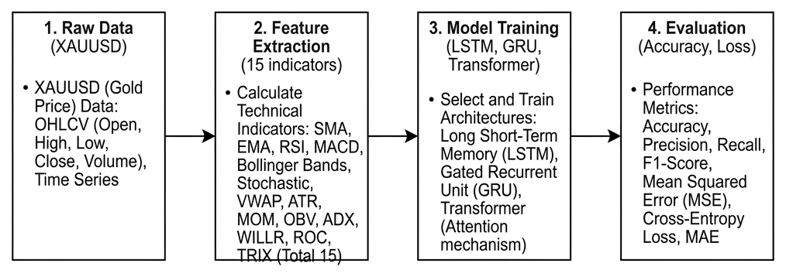
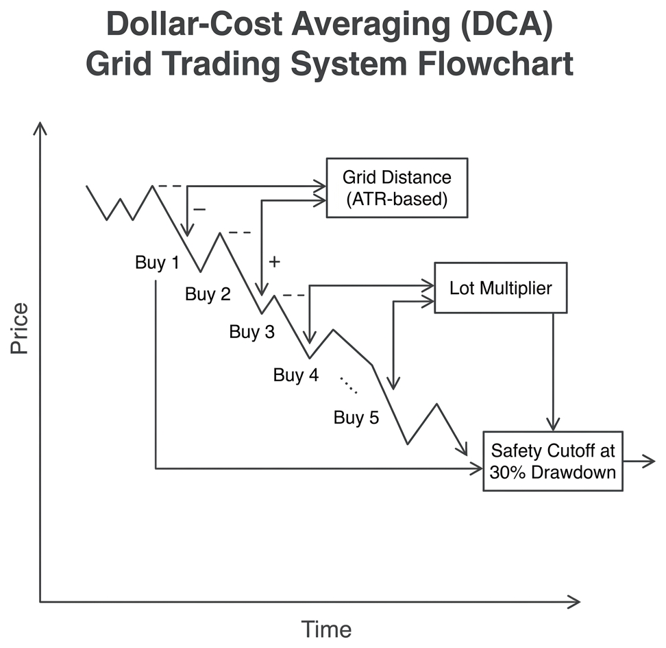

# CHƯƠNG 2. CƠ SỞ LÝ THUYẾT VÀ CÔNG NGHỆ ÁP DỤNG

*Chương 2 trình bày cơ sở lý thuyết toán học và các công nghệ nền tảng được áp dụng trong hệ thống hỗ trợ ra quyết định VQuant. Nội dung bao gồm: đặc điểm dữ liệu chuỗi thời gian XAU/USD và các chỉ báo kỹ thuật; cơ sở toán học của mạng tích chập 1D-CNN, mạng hồi quy BiGRU, cơ chế Multi-Head Attention và mô hình đề xuất CNN-BiGRU-Attention; thuật toán so khớp mẫu hình Cosine Similarity; mô hình NLP FinBERT và từ điển VADER; nền tảng MetaTrader 5 (MQL5) và giao tiếp liên tiến trình IPC; thuật toán quản lý vốn ma trận DCA co giãn theo ATR và chiến lược phòng hộ Hedging; cùng các độ đo đánh giá hệ thống.*

---

## 2.1 Phân tích kỹ thuật và xử lý dữ liệu chuỗi thời gian

### 2.1.1 Đặc điểm dữ liệu cặp tỷ giá XAU/USD
Cặp tỷ giá Vàng giao ngay so với Đô la Mỹ (**XAU/USD**) là một trong những sản phẩm tài chính có tính thanh khoản cao nhất thế giới, với khối lượng giao dịch bình quân vượt 150 tỷ USD mỗi ngày. Thị trường hoạt động liên tục 24/5 từ thứ Hai đến thứ Sáu.

Dữ liệu chuỗi thời gian của cặp XAU/USD có 3 đặc điểm động học cơ bản:
1. **Biên độ biến động lớn:** Biên độ dao động trung bình hàng ngày (Daily ATR) của vàng thường nằm trong khoảng $20 - $40/ounce, và có thể lên tới $60 - $100/ounce khi xuất hiện các sự kiện kinh tế hoặc địa chính trị bất ngờ.
2. **Tương quan chặt chẽ với các biến số vĩ mô:** Giá vàng chịu tác động nghịch biến rõ nét từ chỉ số Dollar Index (DXY) và chính sách lãi suất của Cục Dự trữ Liên bang Mỹ (FED). Khi đồng USD mạnh lên, giá vàng chịu áp lực giảm và ngược lại.
3. **Tính chất phi tuyến và tỷ lệ nhiễu cao:** Khoảng 65% – 70% thời gian thị trường nằm trong trạng thái tích lũy dao động hẹp (Sideway), và chỉ khoảng 30% – 35% thời gian xuất hiện xu hướng rõ ràng (Trending).

### 2.1.2 Các chỉ báo kỹ thuật cốt lõi
Để chuyển đổi dữ liệu nến thô (OHLCV: Open, High, Low, Close, Volume) thành các đặc trưng toán học phục vụ huấn luyện mô hình học máy, hệ thống tính toán 7 nhóm chỉ báo kỹ thuật kinh điển:

#### 1. Đường trung bình động hàm mũ (Exponential Moving Average - EMA)
Đường EMA gán trọng số suy giảm theo hàm mũ cho các mức giá gần nhất, giúp phản ứng nhanh hơn so với đường trung bình động giản đơn (SMA):

$$EMA_t = P_t \times \alpha + EMA_{t-1} \times (1 - \alpha)$$

Trong đó $P_t$ là giá đóng cửa tại thời điểm $t$, hệ số làm mượt $\alpha = \frac{2}{N + 1}$ với $N$ là chu kỳ nến ($N = 20$ và $N = 50$). Độ lệch tương đối giữa hai đường EMA thể hiện xung lượng xu hướng:

$$\Delta EMA_t = \frac{EMA_{20, t} - EMA_{50, t}}{EMA_{50, t}} \times 100\%$$

#### 2. Chỉ số sức mạnh tương đối (Relative Strength Index - RSI)
RSI đo lường xung lực biến động giá nhằm xác định vùng quá mua ($RSI > 70$) hoặc quá bán ($RSI < 30$) trên miền giá trị $[0, 100]$:

$$RSI = 100 - \left( \frac{100}{1 + RS} \right), \quad RS = \frac{\text{Average Gain}_n}{\text{Average Loss}_n}$$

Chỉ số RSI 14 chu kỳ ($RSI_{14}$) được chuẩn hóa về đoạn $[0, 1]$ qua phép biến đổi: $RSI_{\text{norm}} = \frac{RSI_{14}}{100}$.

#### 3. Đường trung bình động hội tụ phân kỳ (MACD)
MACD phản ánh sự tương tác động lượng giữa xu hướng ngắn hạn và trung hạn:

$$\text{MACD Line} = EMA_{12}(P) - EMA_{26}(P)$$

$$\text{Signal Line} = EMA_{9}(\text{MACD Line})$$

$$\text{MACD Histogram} = \text{MACD Line} - \text{Signal Line}$$

Khi Histogram chuyển từ âm sang dương, xung lực tăng bắt đầu chiếm ưu thế và ngược lại.

#### 4. Dải băng Bollinger (Bollinger Bands)
Dải Bollinger xác định biên độ dao động chuẩn tắc xung quanh đường trung bình động $SMA_{20}$:

$$\text{Middle Band} = SMA_{20}(P)$$

$$\text{Upper Band} = SMA_{20}(P) + 2 \times \sigma_{20}$$

$$\text{Lower Band} = SMA_{20}(P) - 2 \times \sigma_{20}$$

Trong đó $\sigma_{20}$ là độ lệch chuẩn giá đóng cửa 20 chu kỳ. Tỷ lệ vị trí giá trong dải (%B) được tính theo công thức:

$$\%B = \frac{P_t - \text{Lower Band}}{\text{Upper Band} - \text{Lower Band}}$$

#### 5. Chỉ báo dao động ngẫu nhiên (Stochastic Oscillator)
Stochastic đo lường vị trí giá đóng cửa so với biên độ đỉnh - đáy trong 14 chu kỳ nến:

$$\%K = \frac{Close_t - \min_{14}(Low)}{\max_{14}(High) - \min_{14}(Low)} \times 100, \quad \%D = SMA_3(\%K)$$

#### 6. Tốc độ thay đổi giá (Rate of Change - ROC)
ROC phản ánh gia tốc biến động của đường giá so với 10 nến trước đó:

$$ROC_t = \frac{Close_t - Close_{t-10}}{Close_{t-10}} \times 100\%$$

#### 7. Độ biến động thực tế trung bình (Average True Range - ATR)
ATR đo lường biên độ dao động thực tế của nến. Phạm vi thực tế (True Range - TR) tại nến $t$ được xác định bởi:

$$TR_t = \max \left( High_t - Low_t, \, |High_t - Close_{t-1}|, \, |Low_t - Close_{t-1}| \right)$$

Chỉ số ATR 14 chu kỳ được tính theo công thức làm mượt của Wilder:

$$ATR_{14, t} = \frac{ATR_{14, t-1} \times 13 + TR_t}{14}$$

Chỉ số ATR không chỉ là đặc trưng đầu vào cho mô hình AI mà còn đóng vai trò then chốt để thuật toán Robot MQL5 tự động co giãn bước giá lưới lệnh (Grid Spacing) và khoảng cách chốt lời.

Sau quá trình tính toán, hệ thống trích xuất tổng cộng 20 đặc trưng kỹ thuật chuẩn hóa cho mỗi bước thời gian. Mức độ đóng góp của các nhóm đặc trưng được phân tích trực quan trên Hình 2.1:

---

## 2.2 Các mô hình học sâu và so khớp mẫu hình

### 2.2.1 Mạng nơ-ron tích chập một chiều (1D-CNN)
Mạng tích chập một chiều (1D-CNN) là giải pháp hiệu quả để trích xuất đặc trưng hình thái từ dữ liệu chuỗi thời gian đa biến (Multivariate Time Series). 

Phép tích chập 1D thực hiện trượt một bộ lọc (Kernel) kích thước $(k, d)$ dọc theo trục thời gian:

$$y_t = f \left( \sum_{i=0}^{k-1} W_i \cdot x_{t+i} + b \right)$$

Trong đó $x_t \in \mathbb{R}^d$ là vector đặc trưng tại thời điểm $t$ ($d = 20$), $W \in \mathbb{R}^{k \times d}$ là ma trận trọng số bộ lọc, $b$ là hệ số điều chỉnh bias và $f(\cdot)$ là hàm kích hoạt phi tuyến ReLU.

Ưu điểm nổi bật của 1D-CNN trong bài toán tài chính:
–  **Khả năng bất biến tịnh tiến cục bộ:** Nhận diện các mẫu hình nến đảo chiều điển hình (Pinbar, nến nhấn chìm Engulfing) mà không phụ thuộc vào mức giá tuyệt đối.
–  **Chia sẻ trọng số (Weight Sharing):** Giảm thiểu số lượng tham số cần tối ưu, giúp mô hình hạn chế hiện tượng học vẹt (Overfitting) so với mạng nơ-ron truyền thống.

### 2.2.2 Mạng hồi quy có cổng hai chiều (BiGRU)
Mạng hồi quy truyền thống (RNN) gặp phải vấn đề triệt tiêu hoặc bùng nổ đạo hàm khi xử lý chuỗi dài. Mô hình GRU (Gated Recurrent Unit) khắc phục nhược điểm này thông qua hai cổng kiểm soát dòng thông tin:

$$\text{Cổng cập nhật (Update Gate):} \quad z_t = \sigma(W_z x_t + U_z h_{t-1} + b_z)$$

$$\text{Cổng đặt lại (Reset Gate):} \quad r_t = \sigma(W_r x_t + U_r h_{t-1} + b_r)$$

$$\text{Trạng thái ứng viên (Candidate State):} \quad \tilde{h}_t = \tanh(W_h x_t + U_h (r_t \odot h_{t-1}) + b_h)$$

$$\text{Trạng thái ẩn cuối cùng (Hidden State):} \quad h_t = (1 - z_t) \odot h_{t-1} + z_t \odot \tilde{h}_t$$

So với mô hình LSTM, GRU giảm bớt khoảng 25% tham số tính toán nhưng vẫn duy trì hiệu năng tương đương, giúp tăng tốc độ suy luận và giảm rủi ro quá khớp trên tập dữ liệu chuỗi nến tài chính.

Trong một cửa sổ trượt quá khứ $T = 50$ nến H4, kiến trúc **BiGRU (Bidirectional GRU)** xem xét chuỗi theo cả hai chiều thời gian thuận và nghịch:

$$\vec{h}_t = \overrightarrow{\text{GRU}}(x_t, \vec{h}_{t-1}), \quad \overleftarrow{h}_t = \overleftarrow{\text{GRU}}(x_t, \overleftarrow{h}_{t+1}), \quad H_t = [\vec{h}_t \,\|\, \overleftarrow{h}_t]$$

Trạng thái tổng hợp $H_t$ giúp mô hình nắm bắt trọn vẹn cả xung lực tích lũy từ quá khứ lẫn phản ứng giá tại các điểm đảo chiều.

### 2.2.3 Cơ chế Chú ý đa đầu (Multi-Head Self-Attention)
Trong chuỗi 50 nến H4, các cây nến không có vai trò bình đẳng đối với xu hướng tiếp theo. Cơ chế Chú ý (Self-Attention) cho phép mô hình tự động gán trọng số tập trung vào những cây nến mang tính bước ngoặt (nến phá vỡ Breakout hoặc nến bão tin vĩ mô).

Đầu ra $H$ từ tầng BiGRU được chiếu tuyến tính thành ba ma trận Truy vấn ($Q$), Khóa ($K$) và Giá trị ($V$):

$$Q = H W^Q, \quad K = H W^K, \quad V = H W^V$$

Trọng số chú ý được tính thông qua tích vô hướng chuẩn hóa:

$$\text{Attention}(Q, K, V) = \text{softmax}\left( \frac{Q K^T}{\sqrt{d_k}} \right) V$$

Trong đó hệ số chia $\sqrt{d_k}$ giúp ổn định gradient. Mô hình mở rộng sang kiến trúc **Multi-Head Attention** với $h = 4$ đầu chú ý độc lập:

$$\text{head}_i = \text{Attention}(Q W_i^Q, K W_i^K, V W_i^V)$$

$$\text{MultiHead}(Q, K, V) = \text{Concat}(\text{head}_1, \dots, \text{head}_h) W^O$$

Để duy trì dòng gradient và bảo toàn thông tin nền tảng, đầu ra được cộng kết nối tắt (Residual Connection) kết hợp chuẩn hóa tầng (LayerNorm):

$$\text{Output}_{\text{Attn}} = \text{LayerNorm}\left( H + \text{MultiHead}(H, H, H) \right)$$

### 2.2.4 Mô hình đề xuất CNN-BiGRU-Attention
Đề tài đề xuất mô hình lai **CNN-BiGRU-Attention** tích hợp điểm mạnh của cả ba cơ chế:
–  **Khối Dual 1D-CNN:** Gồm tầng Conv1D (48 bộ lọc, kernel=3) kèm Batch Normalization, tiếp nối bởi Conv1D (32 bộ lọc, kernel=3) và MaxPooling1D(2) để trích xuất đặc trưng hình thái nến.
–  **Khối BiGRU:** 32 units xử lý chuỗi 2 chiều, trả về chuỗi vector trạng thái thời gian.
–  **Khối Multi-Head Attention:** 4 heads chú ý tự động cân chỉnh trọng số nến quan trọng.
–  **Tầng nén & Phân loại:** GlobalAveragePooling1D nén chuỗi thời gian, đi qua các tầng Dense(32, ReLU), Dropout(0.2), Dense(16, ReLU) và kết thúc bằng tầng Softmax 3 lớp: $[P(\text{HOLD}), P(\text{BUY}), P(\text{SELL})]$.

Để giải quyết bài toán mất cân bằng nhãn (lớp HOLD thường chiếm tỷ lệ cao hơn BUY và SELL), hàm mất mát Categorical Cross-Entropy có trọng số lớp (Class Weights) được áp dụng:

$$\mathcal{L} = - \sum_{c=1}^{3} w_c \cdot y_c \cdot \log(\hat{y}_c), \quad w_c = \frac{N_{\text{total}}}{3 \times N_c}$$

Quy trình tiền xử lý dữ liệu và luồng huấn luyện mô hình được mô tả chi tiết trên Hình 2.2:

### 2.2.5 Thuật toán so khớp mẫu hình (KNN Pattern Matcher)
Bên cạnh mô hình học sâu, hệ thống kết hợp thuật toán so khớp mẫu hình giá dựa trên nguyên lý: "Biến động thị trường trong quá khứ có xu hướng tự lặp lại":

1. Trích xuất vector giá đóng cửa $P = [p_1, p_2, \dots, p_K]$ của $K=20$ nến hiện tại.
2. Chuẩn hóa hình dáng đường giá theo phương pháp Min-Max cục bộ để loại bỏ yếu tố mức giá tuyệt đối:

$$\bar{p}_i = \frac{p_i - \min(P)}{\max(P) - \min(P)}$$

3. Quét toàn bộ kho dữ liệu lịch sử $N$ nến H4, trích xuất từng cửa sổ trượt $Q_j$ độ dài $K$ và chuẩn hóa thành $\bar{Q}_j$.
4. Tính độ tương đồng Cosine (Cosine Similarity) giữa vector hiện tại $\bar{P}$ và từng vector quá khứ $\bar{Q}_j$:

$$\text{Sim}(\bar{P}, \bar{Q}_j) = \frac{\bar{P} \cdot \bar{Q}_j}{\|\bar{P}\|_2 \cdot \|\bar{Q}_j\|_2} = \frac{\sum_{i=1}^{K} \bar{p}_i \bar{q}_{j,i}}{\sqrt{\sum_{i=1}^{K} \bar{p}_i^2} \sqrt{\sum_{i=1}^{K} \bar{q}_{j,i}^2}}$$

5. Chọn lọc Top 5 kịch bản lịch sử có độ tương đồng cao nhất ($\text{Sim} \ge 0.90$). Nếu đa số các kịch bản tương đồng sau đó tăng giá, hệ thống sẽ cộng điểm thiên hướng (Probability Bias) cho quyết định BUY và ngược lại.

---

## 2.3 Xử lý ngôn ngữ tự nhiên trong phân tích tin tức

### 2.3.1 Mô hình ngôn ngữ FinBERT
**FinBERT** là mô hình xử lý ngôn ngữ tự nhiên dựa trên kiến trúc Transformer hai chiều (BERT), được huấn luyện chuyên sâu trên kho ngữ liệu tài chính Wall Street (Financial PhraseBank, báo cáo tài chính thường niên 10-K, 10-Q, tin tức Reuters và Bloomberg).

Khác với các mô hình ngôn ngữ chung, FinBERT hiểu chính xác ngữ nghĩa chuyên ngành của các thuật ngữ kinh tế (ví dụ: từ "hawkish" thể hiện chính sách tiền tệ thắt chặt, từ "yield surge" thể hiện lợi suất trái phiếu tăng vọt), cho phép phân loại sắc thái câu chữ thành 3 nhãn: Tích cực (Positive), Tiêu cực (Negative) hoặc Trung tính (Neutral).

### 2.3.2 Phân tích cảm xúc dựa trên từ điển VADER
Để đáp ứng yêu cầu xử lý tức thời với độ trễ thấp trên máy trạm thực thi, hệ thống kết hợp mô hình FinBERT với bộ từ điển phân tích cảm xúc tài chính mở rộng **VADER Financial Lexicon**:

**Bảng 2.1: Bảng trọng số từ khóa kinh tế vĩ mô trong hệ thống**

| Từ khóa kinh tế vĩ mô | Nhóm tác động | Trọng số tác động | Ý nghĩa thực tế |
| :--- | :---: | :---: | :--- |
| `hawkish` / `rate hike` | USD tăng / Vàng giảm | +3.5 | Lãi suất tăng khiến vàng chịu áp lực bán |
| `dovish` / `rate cut` | USD giảm / Vàng tăng | -3.5 | Hạ lãi suất kích thích dòng vốn vào vàng |
| `inflation surge` / `sticky cpi` | USD tăng / Vàng giảm | +2.8 | Lạm phát dai dẳng khiến FED duy trì thắt chặt |
| `geopolitical tension` / `war crisis` | Vàng trú ẩn tăng | +4.0 | Rủi ro địa chính trị thúc đẩy mua vàng an toàn |
| `recession fears` / `banking crisis` | Vàng trú ẩn tăng | +3.2 | Khủng hoảng kinh tế làm tăng nhu cầu tích trữ vàng |

### 2.3.3 Thuật toán đảo chiều cảm xúc vĩ mô
Phần lớn tin tức kinh tế quốc tế phản ánh sức khỏe của đồng USD. Đối với cặp tỷ giá XAU/USD, tin tức kinh tế Mỹ tích cực sẽ làm đồng USD tăng giá mạnh nhưng lại tạo áp lực bán tháo lên Vàng. Do đó, hệ thống thiết lập cơ chế đảo chiều cảm xúc:

$$\text{Sentiment}_{\text{Final}}(XAU) = 
\begin{cases} 
- \text{Score}_{USD} & \text{với tin tức kinh tế Mỹ (FED, CPI, Non-Farm, GDP)} \\
+ \text{Score}_{\text{SafeHaven}} & \text{với tin tức địa chính trị, chiến tranh, khủng hoảng} \\
0 & \text{với tin tức trung tính hoặc không liên quan}
\end{cases}$$

Điểm cảm xúc $\text{Sentiment}_{\text{Final}} \in [-1.0, +1.0]$ được sử dụng để điều chỉnh xác suất vào lệnh. Khi phát hiện tin tức kinh tế cực mạnh (Tin đỏ sắp công bố trong vòng 30 phút), màng lọc Sentinel 24/7 sẽ phát tín hiệu ngắt mạch an toàn (News Circuit Breaker) để tạm dừng mở vị thế mới.

---

## 2.4 Nền tảng MetaTrader 5 và cơ chế giao tiếp liên tiến trình

### 2.4.1 Nền tảng MetaTrader 5 và ngôn ngữ MQL5
**MetaTrader 5 (MT5)** là nền tảng giao dịch tài chính tiêu chuẩn thế giới, cung cấp khả năng khớp lệnh tốc độ cao (mili-giây) và quản lý tài khoản trực tiếp với các sàn môi giới (Broker).

Robot Expert Advisor được lập trình bằng ngôn ngữ **MQL5** theo mô hình Lập trình hướng đối tượng (OOP), chia thành các lớp chức năng độc lập:
–  `CInputs`: Quản lý và chuẩn hóa toàn bộ tham số cấu hình.
–  `CFileBridge`: Lắng nghe và đọc tệp tín hiệu từ tiến trình Python.
–  `CFilters`: Tính toán các chỉ báo kỹ thuật trực tiếp trên đồ thị nến.
–  `CGridManager`: Quản lý thuật toán lưới DCA và tính toán điểm hòa vốn.
–  `COrderManager`: Đóng gói và gửi yêu cầu giao dịch `MqlTradeRequest` tới máy chủ sàn.
–  `CDashboard`: Bảng điều khiển giao diện đồ họa nút bấm trực tiếp trên biểu đồ.

### 2.4.2 Cơ chế giao tiếp liên tiến trình (IPC)
Tiến trình phân tích AI chạy trên Python và Robot thực thi lệnh chạy trên MetaTrader 5 hoạt động độc lập trong hai không gian bộ nhớ riêng biệt. Hệ thống thiết lập cầu nối giao tiếp liên tiến trình (IPC) thông qua tệp chia sẻ trung gian (`vc_signal_XAUUSD.txt`) đặt tại thư mục dùng chung của MT5 (`Common/Files`).

Mỗi chu kỳ nến H4, Python xuất ra bản ghi định dạng JSON:
`{"timestamp": "2026-10-25 14:00:00", "signal": "BUY", "confidence": 0.68, "atr": 28.5}`

**Cơ chế phòng thủ an toàn (Watchdog Timeout):**
Mỗi khi đọc tệp tín hiệu, Robot MQL5 kiểm tra độ chênh lệch thời gian:

$$\Delta T = T_{\text{current}} - T_{\text{signal}}$$

–  Nếu $\Delta T \le 4\text{ giờ}$: Tín hiệu còn hiệu lực, Robot thực thi lệnh theo định hướng của AI.
–  Nếu $\Delta T > 4\text{ giờ}$ hoặc tệp không tồn tại: Robot tự động kích hoạt trạng thái an toàn `AI_OFFLINE / FAILSAFE`, hiển thị cảnh báo trên biểu đồ và chuyển sang chế độ tự hành bảo toàn vốn, ngăn chặn rủi ro thực thi theo tín hiệu cũ đã lỗi thời.

---

## 2.5 Thuật toán quản lý vốn và phòng ngừa rủi ro

### 2.5.1 Giới hạn của dự báo và vai trò của quản lý vốn
Thị trường tài chính là một hệ thống ngẫu nhiên bán hiệu quả, thường xuyên xuất hiện các sự kiện đột biến không thể dự báo chính xác 100%. Một hệ thống giao dịch tự động không thể chỉ phụ thuộc vào độ chính xác của mô hình học máy mà yếu tố quyết định sự tồn tại lâu dài là **thuật toán quản lý vốn và kiểm soát rủi ro**.

Triết lý của hệ thống: **AI định hướng xu hướng vĩ mô — Thuật toán quản lý vốn lưới ma trận bảo vệ tài khoản và khai thác lợi nhuận vi mô**.

### 2.5.2 Thuật toán lưới DCA co giãn theo ATR
Chiến lược trung bình giá (DCA) truyền thống sử dụng bước giá cố định (ví dụ: cách nhau 20 points). Khi thị trường xuất hiện bão giá biến động hàng trăm USD, việc nhồi lệnh dày đặc sẽ nhanh chóng làm cạn kiệt tiền ký quỹ dẫn đến cháy tài khoản.

Hệ thống VQuant giải quyết triệt để rủi ro này bằng thuật toán **Lưới DCA co giãn theo biến động ATR**:

#### 1. Bước giá co giãn động
Khoảng cách giá để mở lệnh thứ $k$ ($k \ge 1$) được điều chỉnh theo công thức:

$$\text{Spacing}_k = \text{BaseSpacing} \times \left( \frac{ATR_{14, \text{current}}}{ATR_{14, \text{baseline}}} \right) \times \gamma^{(k-1)}$$

Trong đó $\text{BaseSpacing}$ là bước giá cơ sở, $ATR_{14, \text{current}}$ là độ biến động nến thực tế tại thời điểm mở lệnh, và $\gamma \ge 1.0$ là hệ số giãn nở bước giá lũy tiến (ví dụ: $\gamma = 1.15$). Khi thị trường biến động mạnh, bước giá tự động dãn rộng để giảm thiểu số lượng lệnh phải gánh.

#### 2. Khối lượng lũy tiến kiểm soát
Khối lượng lệnh thứ $k$ tuân theo nguyên tắc:

$$\text{Lot}_k = \min \left( \text{BaseLot} \times \beta^{(k-1)}, \, \text{MaxLotLimit} \right)$$

Hệ số nhân $\beta$ được cấu hình ở mức thận trọng ($1.2 \le \beta \le 1.4$), tránh nhân đôi lot theo kiểu Martingale nguy hiểm ($\beta = 2.0$).

#### 3. Điểm hòa vốn tổng hòa (Consolidated Break-Even Target)
Thay vì chốt lời từng lệnh đơn lẻ, thuật toán tính toán mức giá hòa vốn bình quân gia quyền của toàn bộ rổ lệnh:

$$P_{\text{BreakEven}} = \frac{\sum_{i=1}^{m} \text{Lot}_i \times \text{OpenPrice}_i}{\sum_{i=1}^{m} \text{Lot}_i}$$

Mức chốt lời tổng thể được dời về: $P_{\text{TP}} = P_{\text{BreakEven}} \pm \Delta_{\text{Target}}$. Chỉ cần thị trường có một nhịp hồi nhẹ (Pullback chiếm 25% – 35% biên độ sóng giảm), toàn bộ rổ lệnh sẽ tự động đóng đồng loạt với tổng lợi nhuận dương.

Nguyên lý co giãn bước giá và tối ưu điểm hòa vốn được minh họa chi tiết trên Hình 2.3:

### 2.5.3 Cơ chế phòng hộ hai chiều (Hedging)
Để phòng ngừa các đợt bão giá một chiều cực đoan, hệ thống tích hợp cơ chế phòng vệ **Hedging**:
1. **Khóa rủi ro thả nổi (Drawdown Lock):** Khi mức sụt giảm vốn thả nổi của rổ lệnh chạm ngưỡng cảnh báo cấu hình ($\text{Drawdown} \ge 25\%$), Robot tự động mở vị thế đối ứng có khối lượng tương đương theo chiều ngược lại:
   $$\text{Lot}_{\text{Hedge}} = \left| \sum \text{Lot}_{\text{BUY}} - \sum \text{Lot}_{\text{SELL}} \right|$$
   Khi vị thế phòng hộ được xác lập, toàn bộ mức lỗ tạm thời của tài khoản bị đóng băng hoàn toàn.
2. **Cơ chế tháo gỡ từng phần (Gradual Unwind):** Khi mô hình AI nhận diện xu hướng cực đoan đã suy kiệt trên khung H4, Robot sẽ kích hoạt chu trình tháo gỡ từng cặp lệnh đối nghịch có lãi, đưa trạng thái tài khoản trở về vùng an toàn mà không phải chịu tổn thất cắt lỗ đột ngột.

---

## 2.6 Các độ đo đánh giá hệ thống

### 2.6.1 Độ đo đánh giá mô hình học máy
Từ ma trận nhầm lẫn (Confusion Matrix) cho bài toán phân loại 3 lớp (BUY, HOLD, SELL), các độ đo được tính toán theo công thức:

–  **Độ chính xác tổng thể (Accuracy):**
   $$\text{Accuracy} = \frac{\sum_{c=1}^{3} TP_c}{N_{\text{total}}}$$

–  **Độ chuẩn xác (Precision):**
   $$\text{Precision}_c = \frac{TP_c}{TP_c + FP_c}$$

–  **Độ thu hồi (Recall):**
   $$\text{Recall}_c = \frac{TP_c}{TP_c + FN_c}$$

–  **Điểm F1 trung bình điều hòa (Macro F1-Score):**
   $$F1_c = 2 \times \frac{\text{Precision}_c \times \text{Recall}_c}{\text{Precision}_c + \text{Recall}_c}, \quad \text{Macro } F1 = \frac{1}{3} \sum_{c=1}^{3} F1_c$$

*Ý nghĩa thống kê:* Với bài toán phân loại 3 lớp trên dữ liệu chuỗi thời gian tài chính có độ nhiễu cao, độ chính xác ngẫu nhiên là $33.33\%$. Do đó, mô hình đạt độ chính xác từ $36\% - 42\%$ với Macro F1 cân bằng đã đại diện cho một lợi thế thống kê thực tế có ý nghĩa.

### 2.6.2 Độ đo đánh giá hiệu quả tài chính
Hệ thống sử dụng các chỉ số định lượng tài chính chuẩn mực để đo lường mức độ tương quan giữa lợi nhuận và rủi ro:

–  **Mức sụt giảm tài khoản tối đa (Maximum Drawdown - MDD):**
   $$\text{Drawdown}_t = \frac{\max_{0 \le \tau \le t}(Equity_\tau) - Equity_t}{\max_{0 \le \tau \le t}(Equity_\tau)}, \quad MDD = \max_{t} (\text{Drawdown}_t) \times 100\%$$
   Chỉ số đo lường rủi ro vốn lớn nhất từng xảy ra; yêu cầu hệ thống duy trì MDD dưới ngưỡng 25%.

–  **Tỷ số Sharpe (Sharpe Ratio):** Đo lường lợi nhuận vượt trội trên một đơn vị rủi ro tổng thể:
   $$\text{Sharpe Ratio} = \frac{\mathbb{E}[R_p - R_f]}{\sigma_p}$$

–  **Tỷ số Sortino (Sortino Ratio):** Chỉ đo lường rủi ro đối với các biến động sụt giảm vốn tiêu cực:
   $$\text{Sortino Ratio} = \frac{\mathbb{E}[R_p - R_f]}{\sigma_{\text{downside}}}, \quad \sigma_{\text{downside}} = \sqrt{\frac{1}{T} \sum_{t=1}^{T} \min(0, R_{p,t} - R_f)^2}$$

–  **Tỷ số Calmar (Calmar Ratio):** Đo lường tỷ lệ giữa lợi nhuận kép hàng năm và mức sụt giảm lớn nhất:
   $$\text{Calmar Ratio} = \frac{\text{Annualized Compound Return}}{MDD}$$

–  **Hệ số sinh lời (Profit Factor - PF):** Tỷ lệ giữa tổng tiền lãi và tổng tiền lỗ:
   $$\text{Profit Factor} = \frac{\sum \text{Gross Profits}}{\sum |\text{Gross Losses}|}$$
   Chiến lược giao dịch được coi là có lãi bền vững khi $\text{Profit Factor} > 1.5$.

---

## 2.7 Tóm tắt chương 2

Trong Chương 2, đồ án đã trình bày toàn diện nền tảng lý thuyết và công nghệ áp dụng cho hệ thống VQuant:
–  Phân tích đặc điểm chuỗi thời gian của cặp XAU/USD và cơ sở toán học của 7 nhóm chỉ báo kỹ thuật cốt lõi (EMA, RSI, MACD, Bollinger Bands, Stochastic, ROC, ATR).
–  Xây dựng cơ sở lý thuyết của mạng học sâu 1D-CNN, mạng hồi quy BiGRU, cơ chế Multi-Head Attention, mô hình kết hợp CNN-BiGRU-Attention và thuật toán so khớp mẫu hình Cosine Similarity.
–  Xây dựng phương pháp phân tích cảm xúc tin tức vĩ mô bằng mô hình Transformer FinBERT kết hợp từ điển VADER và thuật toán đảo chiều cảm xúc.
–  Làm rõ cấu trúc module hướng đối tượng MQL5 trên MetaTrader 5 và cơ chế giao tiếp liên tiến trình IPC qua tệp chia sẻ kèm cơ chế phòng thủ Watchdog Timeout.
–  Thiết lập nguyên lý quản lý vốn lưới ma trận DCA co giãn động theo ATR và chiến lược phòng hộ Hedging khóa rủi ro.
–  Xác lập đầy đủ các độ đo đánh giá cả về mặt Học máy và Tài chính định lượng.

Toàn bộ cơ sở lý thuyết và công nghệ này là nền tảng để triển khai phần **Thiết kế, cài đặt và đánh giá hệ thống** trong **Chương 3**.
